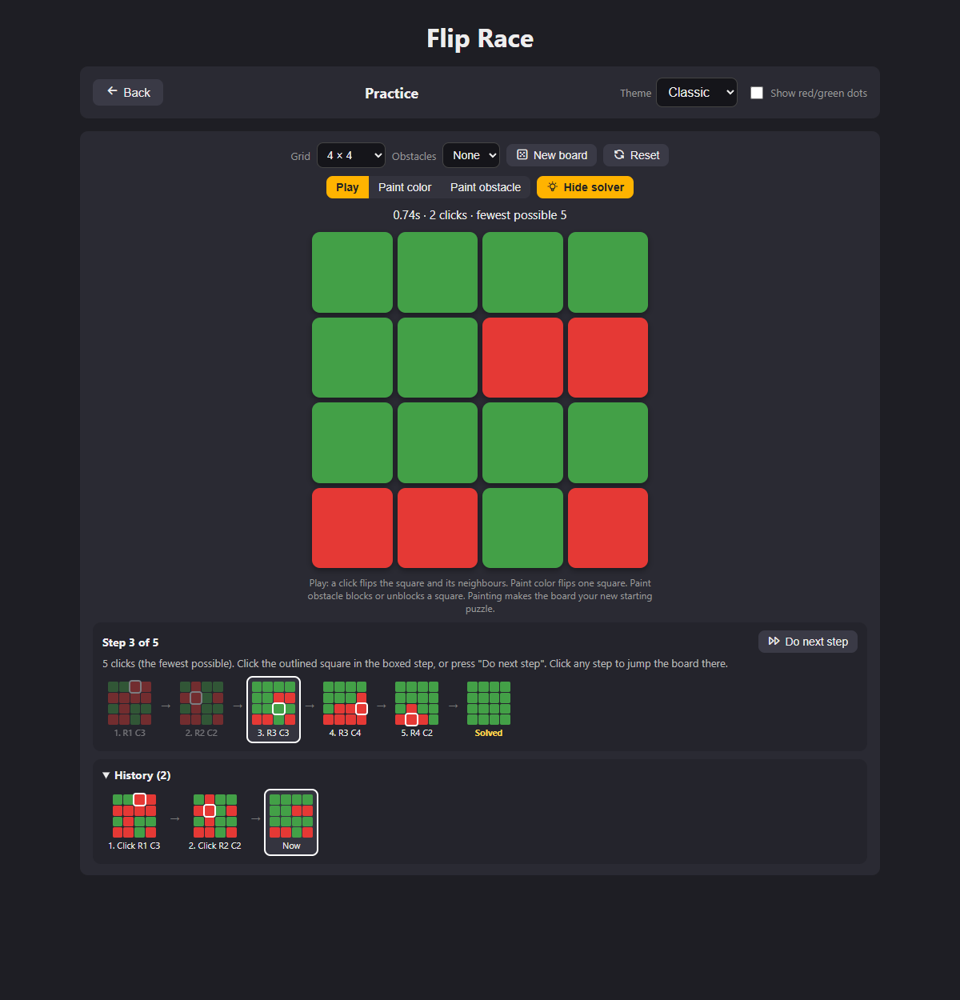
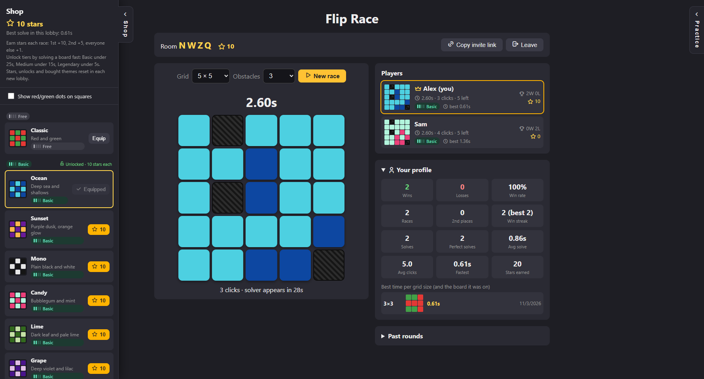
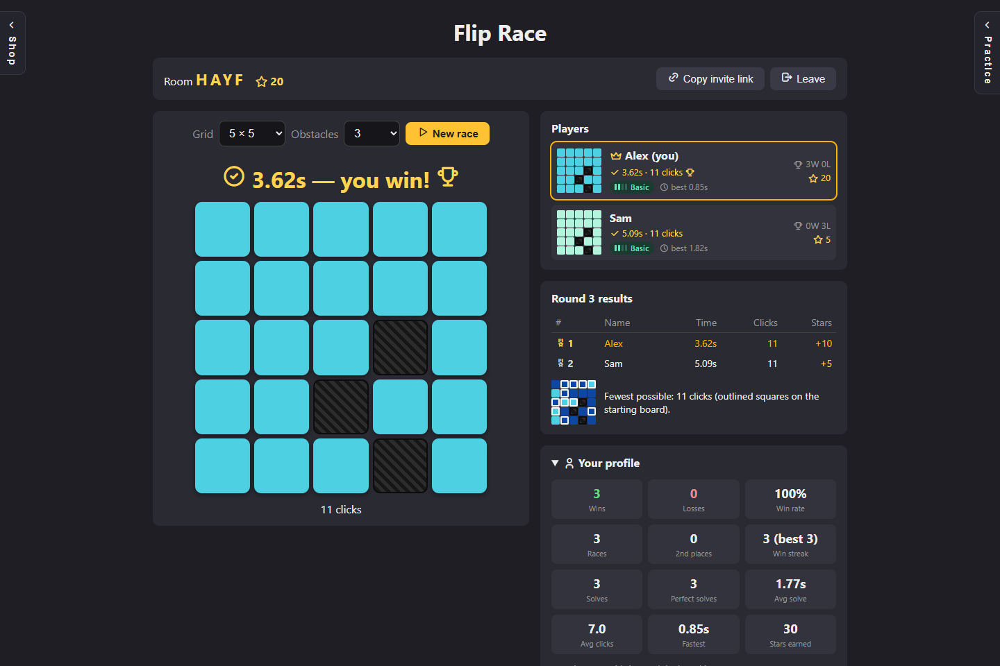

# Flip Race: Lights Out puzzle solver and multiplayer race game

Flip Race is a free **Lights Out puzzle solver** and a multiplayer racing game built around the same puzzle.

In a Lights Out puzzle, clicking a square flips it and the squares directly above, below, left and
right of it. The goal is to make every square the same. Flip Race can:

- **Solve any board for you.** Paint in the board you're stuck on and it shows the fewest clicks
  that solve it, one step at a time.
- **Teach you to solve them yourself.** Practice on random boards from 3×3 to 10×10, with or without
  blocked squares, and check yourself against the solver.
- **Race your friends.** Everyone gets the same board, and the first to clear it wins.



## Games with this puzzle

This kind of puzzle appears in a lot of games. If you're stuck on one, Flip Race can solve it:

- **Heroes of Hammerwatch** has Lights Out puzzles. See this Reddit post analysing them:
  [The Lights Out puzzle has been analyzed and...](https://www.reddit.com/r/heroesofhammerwatch/comments/894j7h/the_lights_out_puzzle_has_been_analyzed_and/)
- **Lethal Company** has one in a mod. We don't know which mod yet. If you do, please open an issue
  or pull request so we can name it here.
- **Dungeons & Dragons Online (DDO)** players have long used Lights Out solvers for its puzzles.
- It is also the classic **Lights Out** handheld game from Tiger Electronics, and it shows up in
  many other games as a light, switch, or tile-flipping puzzle.

**Tip for "turn all the lights ON" puzzles** (like Heroes of Hammerwatch): the solver turns every
square **green**, so treat green as "on". Paint each light that is currently **off** as **red**, then
press **Solve**.

## How to solve a puzzle from another game

1. Open Flip Race and choose **Practice (single player)**.
2. Pick the grid size. If the puzzle has squares that can't be pressed, use **Paint obstacle** to
   block them.
3. Choose **Paint color** and click each square so the board matches your puzzle (red = needs
   flipping).
4. Press **Solve**. The solver shows the fewest clicks needed as a row of small boards. Each one
   outlines the square to press next. Press **Do next step** to apply them one at a time, or click
   any step to jump the board straight there.

The solver always finds the shortest solution, and the clicks can be done in any order. If no
combination of clicks can solve the board (this can happen on some sizes, such as 4×4 and 5×5),
it says so.

## Multiplayer race



- **Rooms:** create a room or join one with a 4-letter code or invite link, and pick a name.
- **Same board for everyone:** grid sizes from 3×3 to 10×10. Every board can be solved and needs at
  least 2 clicks.
- **Obstacles:** the host can add blocked squares that can't be clicked and never flip.
- **Live race view:** every player's board, live clock, click count and squares left.
- **Solver help:** if you're still racing after 30 seconds, the solver shows which squares to click.
- **Practice drawer:** a Practice panel on the right side to try out boards without leaving the room.



After each race you see everyone's times and clicks, plus the fewest possible clicks, outlined on
the starting board.

### Shop and profile

- **Shop:** 25 board themes in four tiers (Free, Basic, Medium, Legendary), bought with stars you
  earn each race (1st +10, 2nd +5, everyone else +1). A tier unlocks once you solve a board fast
  enough: Basic under 25s, Medium under 15s, Legendary under 5s. Skin progress resets in each lobby.
- **Status dots:** an option to show a small red or green dot in each square, so any theme is easy
  to read.
- **Saved profile:** wins, losses, streaks, other stats, and your best time (and board) for each grid
  size. It is stored on the server and in your browser, encrypted with a server key so it can't be
  edited to cheat.

## Running it

Requires [Node.js](https://nodejs.org/) 18 or newer. There are no dependencies to install.

```
npm start
```

Then open http://localhost:3000. Practice mode runs entirely in the browser. Friends on the same
network can use the "On your network" address the server prints.

## Hosting

- **Quick share from your PC:** run `cloudflared tunnel --url http://localhost:3000` and send
  friends the printed link.
- **Always-on hosting** (for example Render): use the start command `npm start`. The server reads the
  `PORT` environment variable.

Set a `PROFILE_SECRET` environment variable when hosting. Profiles are encrypted with a key derived
from it. Without it, the server creates a random key in `data/secret.key`, and if that file is lost
(as on hosts whose disk resets), every saved profile stops working.

The `data/` folder holds the secret key and saved profiles. It is excluded from git and must never
be committed.

## Files

- `server.js`: game server (rooms, boards, solver, scoring, profiles, live updates)
- `public/index.html`: the whole web page (layout, themes, practice mode and solver, game logic)
- `docs/screenshots/`: images used in this README

## Keywords

Lights Out solver, lights out puzzle solver, light puzzle solver, switch puzzle solver, flip puzzle,
tile flip puzzle, Heroes of Hammerwatch lights puzzle, Lethal Company lights puzzle, DDO lights out.
